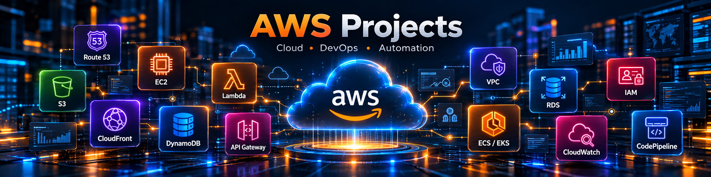
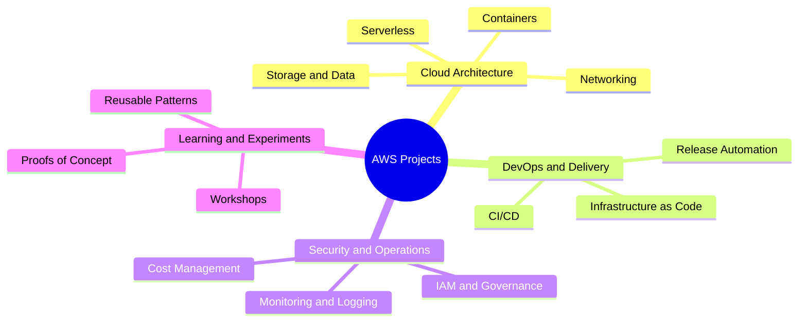

<div align="center">

  

# ☁️ AWS Projects

### The central hub for AWS projects, experiments, and reusable cloud solutions

  <p>
    
    
    
    
  </p>

  <p>
    <a href="#-about">About</a> •
    <a href="#-project-catalog">Catalog</a> •
    <a href="#-getting-started">Getting Started</a> •
    <a href="#-contributing">Contributing</a>
  </p>

</div>

---

## 📖 About

This is the **main repository for the GitHub organization**, bringing together
projects related to **Amazon Web Services (AWS)**. It is the starting point for
discovering cloud projects, learning resources, infrastructure experiments, and
reusable implementation patterns.

The organization focuses on:

- 🏗️ Cloud architecture and modern AWS infrastructure
- ⚙️ DevOps, CI/CD, and operational automation
- 🔐 Security, identity, governance, and observability
- 🚀 Serverless and containerized applications
- 🧪 Proofs of concept, technical experiments, and learning projects
- 📚 Practical documentation and reusable engineering knowledge

> This repository is the organization-level hub. Each project should live in
> its own repository and maintain its own implementation details and
> project-specific documentation.

## 🧭 Project Catalog

The catalog below is intentionally kept up to date as projects are added to the
organization.

| Project       | Description                              | Primary services / tools | Status     |
| ------------- | ---------------------------------------- | ------------------------ | ---------- |
| _Coming soon_ | The project catalog is being established | AWS                      | 🟡 Planned |

### 🗺️ Areas of interest

<table>
  <tr>
    <td align="center">🖥️<br><b>Compute</b><br><sub>EC2 · Lambda · ECS · EKS</sub></td>
    <td align="center">🗄️<br><b>Storage & Data</b><br><sub>S3 · RDS · DynamoDB</sub></td>
    <td align="center">🌐<br><b>Networking</b><br><sub>VPC · Route 53 · CloudFront</sub></td>
  </tr>
  <tr>
    <td align="center">🔌<br><b>Integration</b><br><sub>API Gateway · Event-driven systems</sub></td>
    <td align="center">🔒<br><b>Security</b><br><sub>IAM · Encryption · Governance</sub></td>
    <td align="center">📊<br><b>Observability</b><br><sub>CloudWatch · Logging · Monitoring</sub></td>
  </tr>
  <tr>
    <td align="center">🔄<br><b>DevOps</b><br><sub>CI/CD · CodePipeline · Releases</sub></td>
    <td align="center">🏛️<br><b>Infrastructure as Code</b><br><sub>Terraform · AWS CDK · CloudFormation</sub></td>
    <td align="center">🤖<br><b>Automation</b><br><sub>Repeatable operations and workflows</sub></td>
  </tr>
</table>

## 🏛️ Architecture Overview

The organization is structured around reusable AWS capabilities and project
types. Each implementation should remain independently deployable while
following shared principles for security, observability, automation, and
documentation.



### 🔗 Shared project flow

```text
Idea / Experiment
        │
        ▼
Architecture and Cost Review
        │
        ▼
Implementation with Infrastructure as Code
        │
        ▼
Validation, Security Checks, and Tests
        │
        ▼
Deployment and Observability
        │
        ▼
Documentation, Cleanup, and Iteration
```

This overview describes the organization’s direction rather than a single
runtime architecture. Each project README should provide the detailed
architecture, AWS account boundaries, deployment model, and data flows for that
project.

## 🛠️ Technology Landscape

The projects in this organization may use the following technologies, depending
on their goals and constraints:

<p>
  
</p>

> The badges above describe the organization’s technology landscape, not a
> guarantee that every project uses every technology.

## 🚀 Getting Started

### For users and learners

1. Browse the organization repositories and choose a project.
2. Read that project’s `README.md` for its purpose, architecture, prerequisites,
   and deployment instructions.
3. Configure your AWS account, region, and credentials according to the
   project documentation.
4. Review the expected resources and estimated cost before deployment.
5. Run the project’s validation or test steps.
6. Remove temporary resources when you finish experimenting.

### AWS cost and account safety

AWS resources may incur charges. Before deploying:

- 💳 Check the project’s cost notes and use AWS Free Tier where appropriate.
- 📍 Confirm the target AWS account and region.
- ⏰ Set a budget and billing alert for your account.
- 🧹 Destroy or delete resources that are no longer needed.
- 🔑 Never commit access keys, secret keys, tokens, passwords, or `.env` files.
- 👤 Use a dedicated account or role for experiments whenever possible.

## 📁 Recommended Project Structure

Every project repository should be self-contained. A typical structure may look
like this:

```text
project-name/
├── README.md              # Purpose, architecture, setup, deployment, cleanup
├── docs/                  # Design notes and diagrams
├── src/                   # Application or automation source code
├── infrastructure/        # Terraform, CDK, or CloudFormation definitions
├── tests/                 # Automated and integration tests
├── .github/               # CI/CD workflows and issue templates
└── LICENSE
```

The exact structure may vary by project; clarity and reproducibility matter more
than following this layout mechanically.

## ✅ Project Documentation Checklist

Each project README should explain:

- 🎯 Purpose, scope, and intended audience
- 🏛️ Architecture and a diagram of the main components
- 🧩 AWS services and external dependencies
- 💻 Prerequisites, supported runtimes, and local setup
- ⚙️ Configuration and environment variables
- 🚢 Deployment, testing, rollback, and cleanup procedures
- 💰 Cost considerations and resource sizing
- 🔐 Security assumptions and required IAM permissions
- 🚧 Known limitations, risks, and possible improvements

## 🔐 Engineering Principles

Projects in this organization should aim to:

- Follow the **principle of least privilege** for IAM policies.
- Prefer **Infrastructure as Code** for repeatable environments.
- Keep secrets outside source control and use an appropriate secrets manager.
- Tag AWS resources with project, environment, and owner metadata.
- Enable useful logging and monitoring without exposing sensitive data.
- Automate validation, testing, and deployment where it adds value.
- Document assumptions, trade-offs, and cleanup steps.

## 🤝 Contributing

Contributions, improvements, documentation updates, and new project ideas are
welcome.

1. Open an issue describing the idea, question, or problem.
2. Create a focused branch for your change.
3. Update relevant documentation and add tests where appropriate.
4. Check that no credentials or sensitive data are included.
5. Open a pull request with a clear summary and validation steps.

Please keep pull requests focused and follow the conventions documented in the
affected project repository.

## 🐛 Issues and Support

When reporting a problem, include:

- The affected repository and version or commit.
- The AWS region and runtime information, when relevant.
- Reproduction steps and the expected versus actual behavior.
- Sanitized logs or error messages.

Never include credentials, tokens, account secrets, or other sensitive
information in issues or pull requests.

## 📄 License

The organization-wide license policy will be defined as the repository portfolio
grows. A project may have its own license; always check that project’s
`LICENSE` file before using or distributing its code.

---

<div align="center">
  <sub>Built with ☁️ for learning, experimenting, and building on AWS.</sub>
</div>
